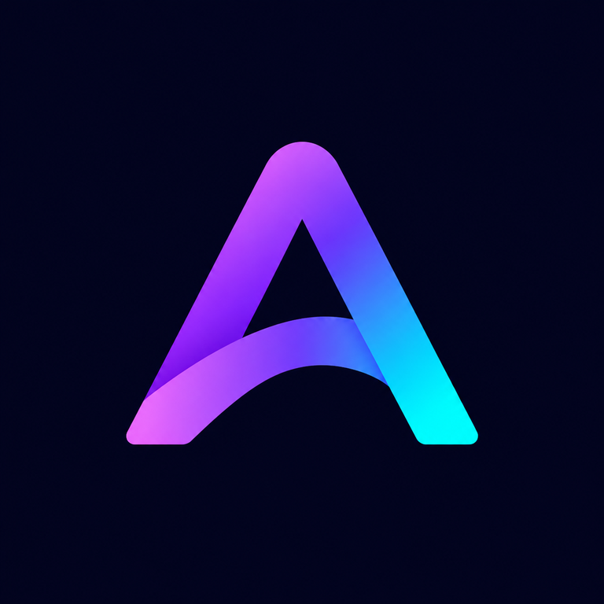

<p align="center">
  
</p>

# ARIA

**ARIA** (*Á-ri-a*) — **A**gentic **R**easoning and **I**ntelligent **A**utomation.
Agentic SDLC Orchestrator.

**Complexity orchestrated. Simplicity delivered.**
· [leandroaps.github.io/aria-orchestrator](https://leandroaps.github.io/aria-orchestrator/)

> "Hey Aria, implement this feature."

An aria is a piece of music; ARIA orchestrates the agents that build your
software. It is a Claude Code plugin that drives a project through the SDLC as
a spec-driven orchestration:

intent → spec → plan → **owner approval** → dispatch to role agents →
**evidence-based acceptance** → review → pull request.

Merge and deploy always stay outside its authority.

## Why another skills pack

Skill packs such as [addyosmani/agent-skills](https://github.com/addyosmani/agent-skills)
and [mattpocock/skills](https://github.com/mattpocock/skills) teach an agent how
to work well. ARIA also **enforces** the process with code:

- a run state machine that decides which task is ready;
- an approval bound to the plan digest and given by a human click, never by
  typed text;
- territory guards that block writes outside the paths a role owns;
- acceptance of a task only against the observed change, not the agent's
  claim;
- a pre-push gate that runs the checks CI would run.

## Status

Pre-alpha. The repository is being extracted from the orchestrator that runs
[bernardo-pet](https://github.com/leandroaps/bernardo-pet); see
[`docs/plan/0001-extraction.md`](docs/plan/0001-extraction.md). Nothing here is
usable yet.

## Install (once released)

```text
/plugin marketplace add leandroaps/aria-orchestrator
/plugin install aria-orchestrator@aria
```

Enforcement relies on Claude Code hooks. Other agents that read `AGENTS.md`
get the skills as guidance only.

## Development

```bash
npm test                # node:test, no dependencies
npm run validate:plugin # claude plugin validate --strict
```

### Pull requests

- Pull requests are opened by the `farofino-bot` GitHub App, never by a
  personal account.
- `main` is protected: merge only through a pull request with the `test`
  check green and an approving review from the code owner (`.github/CODEOWNERS`).
  Force pushes and deletion are blocked, for admins too.

## License

[MIT](LICENSE)
